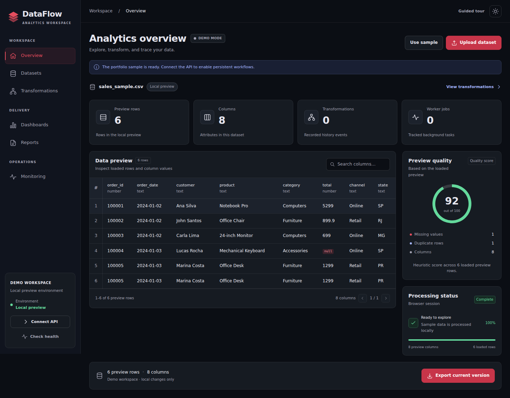
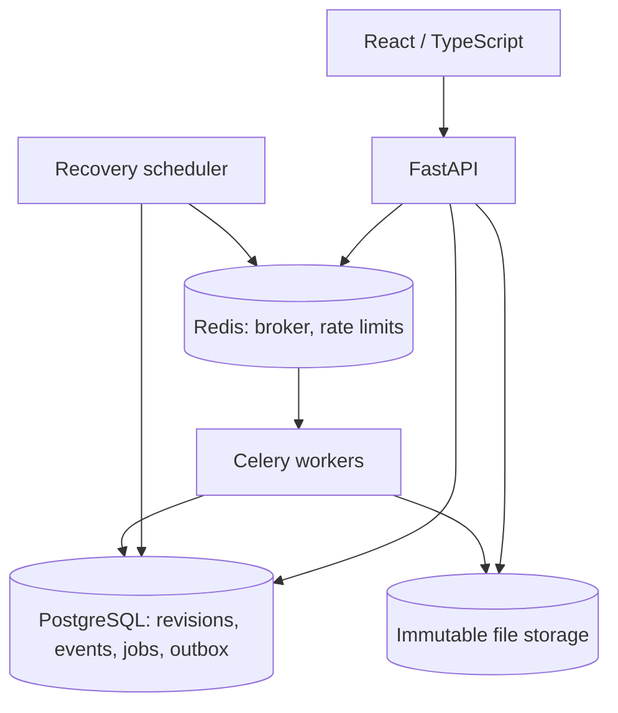

<div align="center">

# DataFlow

### From raw data to clear decisions. Every transformation has a history.

Upload, inspect, transform, undo, and publish analytics from one workspace.

[](https://github.com/MauricioTaguchi/data-analytics-platform/actions/workflows/ci.yml)
[](https://github.com/MauricioTaguchi/data-analytics-platform/actions/workflows/codeql.yml)
[](https://www.python.org/)
[](https://react.dev/)
[](LICENSE)

[Quick start](#quick-start) · [Workspace](#the-workspace) · [Engineering](#engineering-with-evidence) · [Architecture](#architecture) · [Documentation](#documentation)



[Light theme](docs/assets/dashboard-light.png) · [Mobile layout](docs/assets/workspace-mobile.png)

</div>

**DataFlow is a data analytics platform built around traceable, reversible work.** Analysts can explore data quality, preview changes, build dashboards, and generate reports. The backend makes dataset revisions, background jobs, audit events, and recovery explicit, so the same workflow can be inspected and tested beyond the interface.

> **Project status:** a portfolio/reference implementation with implemented failure handling and tested boundaries. Production readiness still requires managed storage, tested backup restoration, high availability, centralized telemetry, formal service objectives, and an independent security review. See [Known limitations](docs/LIMITATIONS.md).

## Quick start

### Explore the local demo

The frontend starts with sample data and a guided tour. No account or backend is required to explore the workspace. Demo changes are kept in memory and are not persisted.

Requirements: Node.js 22 and the pnpm version declared in `frontend/package.json`.

```bash
git clone https://github.com/MauricioTaguchi/data-analytics-platform.git
cd data-analytics-platform/frontend
corepack enable
pnpm install --frozen-lockfile
pnpm dev
```

Open `http://localhost:5173`. Try a transformation, inspect its lineage, and undo it before exploring dashboards and reports.

### Run the complete platform

Requirements: Docker Desktop and Docker Compose. From the repository root:

```bash
cp backend/.env.example backend/.env
docker compose up --build
```

| Service | Local address |
| --- | --- |
| Product | `http://localhost:5173` |
| Interactive API documentation | `http://localhost:8000/docs` |
| Readiness check | `http://localhost:8000/health/ready` |

Create an account through the application to use the live API. PostgreSQL persists projects, revisions, jobs, charts, and dashboards; Redis supports coordination and task delivery; shared volumes retain dataset snapshots and reports. The [sample sales dataset](docs/sample-data/sales.csv) provides a small starting point for the upload workflow.

The one-shot migration service must finish successfully before the API, worker, or scheduler starts. The worker executes jobs; the independent scheduler dispatches pending outbox records and reconciles stale artifacts. For hosted installations and upgrades, follow the [deployment guide](docs/DEPLOYMENT.md) and [recovery procedure](docs/PROCESSING_RECOVERY.md).

## The workspace

The console groups data preparation, delivery, and operations in one responsive navigation. Dark and light themes share the same controls, and the selected theme persists in the browser. Tables paginate the loaded preview; quality indicators explicitly describe those preview rows rather than claiming full-dataset validation.

| Workspace | What you can do |
| --- | --- |
| **Overview** | Review the active dataset, quality indicators, and recent work. |
| **Datasets** | Upload CSV, Excel, JSON, or Parquet; inspect schema and paginated records. |
| **Transformations** | Preview an operation, apply it against an expected version, inspect lineage, and undo completed changes. |
| **Dashboards** | Build persisted charts and interactive dashboards from your datasets. |
| **Reports** | Generate PDF data-quality reports and download completed outputs. |
| **Monitoring** | Inspect processing status, progress, and operational feedback. |

### A complete data workflow

1. **Ingest:** stream an upload through size validation and import it in a worker with progress and cancellation.
2. **Understand:** inspect types, missing values, duplicates, correlations, and outliers before changing the data.
3. **Preview:** materialize a transformation through the selected engine without publishing a new dataset revision.
4. **Apply:** submit an expected revision and idempotency key; follow the asynchronous job through completion.
5. **Verify or undo:** inspect committed events and restore previous content while the revision number keeps increasing.
6. **Share:** build a dashboard, export the current dataset, or generate a PDF quality report.

New transformation outputs use Parquet to preserve column types. Original uploads and historical snapshots remain available for undo. Parquet pagination reads only requested columns and relevant row groups; profiling and chart aggregation still have bounded, eager processing paths.

## Engineering with evidence

The implementation focuses on failure modes that appear when a data workflow crosses HTTP, a queue, a database, and file storage.

| Engineering problem | Implemented behavior | Evidence |
| --- | --- | --- |
| Concurrent transformation and undo | Monotonic revisions, conditional publication, and PostgreSQL locks prevent stale publication. | [Concurrency tests](backend/tests/test_dataset_concurrency.py) |
| A response is lost after undo commits | Transactional audit events retain immutable receipts so the same request can be retried. | [Audit receipt tests](backend/tests/test_dataset_audit_receipts.py) |
| The broker is unavailable or a worker disappears | A transactional outbox, leased attempts, bounded backoff, and a separate scheduler recover committed work. | [Recovery tests](backend/tests/test_outbox_recovery.py) |
| File publication and database commit fail separately | Immutable attempt paths, durable reservations, and repeatable collection reconcile unreferenced artifacts. | [Publication tests](backend/tests/test_transformation_publication.py), [artifact tests](backend/tests/test_artifact_lifecycle.py) |
| Engines disagree about operations or types | Typed parameter contracts, capability preflight, checked casts, and output verification reject unsupported semantics. | [Operation catalog](backend/app/services/operations.py), [engine tests](backend/tests/test_transformation_engines.py) |
| Retries conceal real process failures | Integration tests terminate processes, interrupt broker access, and deliver duplicate messages using real services. | [Process integration tests](backend/integration/test_process_recovery.py) |

### Capacity, isolation, and security

- **Bounded admission:** declared and streamed upload limits, per-process spool concurrency, preflight job/rate checks, and chunked storage validation. Non-upload JSON/form requests have a separate 1 MiB pre-parser body limit, including requests without `Content-Length`.
- **Bounded execution:** per-account storage quotas, expansion checks, guarded transformation outputs, PostgreSQL-backed job ownership and concurrency limits, and worker container resource limits.
- **Account boundaries:** tenant isolation on API access, rotating refresh tokens with single-use server sessions, logout revocation, and consistent problem responses.
- **Shared coordination:** Redis-backed cache, broker, and multi-instance authentication/upload rate limits. Bounded TTL fallback is restricted to local/test environments; Redis is required in production.
- **Lifecycle management:** Alembic-only schema changes, expired-session cleanup, orphan-file reconciliation, and bounded job-history retention.

## Architecture



Transformation rules are separated from publication. Adapters consume a snapshot, transformation plan, and resource policy; the service layer owns leases, revisions, audit events, and transactions. Pandas is the default for bounded workloads. Optional Polars and DuckDB adapters execute supported Parquet projections in supervised subprocesses.

The current storage implementation uses local paths, rename, and fsync. Moving to object storage requires an artifact-reference and local-materialization boundary as well as an adapter. See [Architecture](docs/ARCHITECTURE.md), [Architecture decisions](docs/DECISIONS.md), and [Adding transformations and engines](CONTRIBUTING.md#adding-transformations-and-engines).

## Test and verify

```bash
cd backend
python -m pip install -r requirements-dev.txt -r requirements-engines.txt
python -m ruff check app tests integration
python -m mypy app/core app/services/storage_service.py app/schemas
python -m pytest --cov=app --cov-fail-under=70

cd ../frontend
corepack enable
pnpm install --frozen-lockfile
pnpm typecheck
pnpm test
pnpm build
pnpm exec playwright install chromium
pnpm test:e2e
```

| Validation layer | What it verifies |
| --- | --- |
| Backend tests | Operation contracts, data quality, immutable source data, publication, idempotency, quotas, and API behavior. |
| PostgreSQL tests | Locking and concurrency behavior against a real database in CI. |
| Process integration | API restart, publisher network interruption, duplicate delivery, and worker death after file rename, with eager mode disabled. |
| Frontend and browser tests | Request recovery, preview pagination and missing-value accuracy, keyboard focus, persistent themes, and desktop/mobile workflows, including a live upload-to-undo journey. |
| Repository checks | Migrations, lint, type checks, backend and targeted frontend coverage gates, dependency audits/review, and CodeQL. |

The fast backend suite uses eager task execution. The process suite requires disposable PostgreSQL and Redis services and must be run explicitly; see [Real process integration](CONTRIBUTING.md#real-process-integration). A skipped process suite does not verify recovery. Coverage thresholds are quality gates, not capacity benchmarks.

## Core API workflow

All dataset and job operations below enforce ownership. Interactive request and response schemas are available at `/docs` on a running API.

| Action | Endpoint |
| --- | --- |
| Upload and enqueue import | `POST /api/v1/datasets/project/{project_id}` |
| Inspect progress and result | `GET /api/v1/datasets/jobs/{task_id}` |
| Cancel an owned job | `DELETE /api/v1/datasets/jobs/{task_id}` |
| Read a paginated preview | `GET /api/v1/datasets/{dataset_id}/preview` |
| Enqueue profiling | `POST /api/v1/datasets/{dataset_id}/profile` |
| Preview a transformation | `POST /api/v1/datasets/{dataset_id}/transform/preview` |
| Enqueue an idempotent transformation | `POST /api/v1/datasets/{dataset_id}/transform` |
| Restore previous content | `POST /api/v1/datasets/{dataset_id}/transformations/undo` |
| Read committed transformation and undo events | `GET /api/v1/datasets/{dataset_id}/events` |
| Discover typed operations and engine capabilities | `GET /api/v1/datasets/operations` |
| Create a dashboard | `POST /api/v1/dashboards` |
| Add a chart | `POST /api/v1/dashboards/{id}/charts` |
| Enqueue a PDF report | `POST /api/v1/reports/project/{project_id}/dataset/{dataset_id}` |
| Remove a terminal report and release storage | `DELETE /api/v1/reports/{report_id}` |

Undo accepts a body such as `{"expected_version": 3}`. Supplying `Idempotency-Key` makes a retry return the original receipt; restoring older content still advances the dataset revision. Authentication supports registration, login, automatic refresh-token rotation, and logout/revocation. See [API examples](docs/API_EXAMPLES.md) and [Audit events and receipts](docs/AUDIT_RECEIPTS.md).

## Deliberate trade-offs

- Local versioned files keep development reproducible. Horizontally scaled production needs an appropriate shared-storage design; encrypted object storage is a planned direction.
- Upload receive concurrency is process-local and scales with the number of API workers. Application body guards complement reverse-proxy and ASGI-server size, timeout, and connection limits.
- Pandas operations remain bounded by dataset limits and available memory. Native subprocess memory/spill watchdogs complement container limits; they do not make every operation distributed or streaming.
- Audit events and receipts support recovery and traceability. ORM immutability checks do not protect against privileged direct database writes, and undo does not perform full checksum verification of historical snapshots.
- Chart aggregation is synchronous and bounded by the dataset limit. Large analytical queries need a separate execution strategy.
- Demo changes are non-persistent. The live backend is required to evaluate durable publication, job recovery, and account isolation.

The full scope of these boundaries is recorded in [Known limitations](docs/LIMITATIONS.md).

## Documentation

| Goal | Read |
| --- | --- |
| Understand the design | [Architecture](docs/ARCHITECTURE.md) · [Decisions](docs/DECISIONS.md) |
| Integrate a client | [API examples](docs/API_EXAMPLES.md) · [Audit and undo receipts](docs/AUDIT_RECEIPTS.md) |
| Deploy and operate | [Deployment](docs/DEPLOYMENT.md) · [Operations and observability](docs/OPERATIONS.md) |
| Recover or upgrade | [Processing, recovery, and upgrade procedure](docs/PROCESSING_RECOVERY.md) · [Release process](docs/RELEASES.md) |
| Evaluate boundaries | [Known limitations](docs/LIMITATIONS.md) · [Security model](docs/SECURITY.md) |
| Extend the platform | [Contributing](CONTRIBUTING.md) · [Transformation and engine contracts](CONTRIBUTING.md#adding-transformations-and-engines) |

## Next engineering milestones

- S3/MinIO storage with artifact references, encrypted objects, and signed downloads.
- OpenTelemetry traces and centralized error monitoring.
- Column-level validation contracts and scheduled quality rules.
- Measured memory/latency benchmarks, incremental quota accounting, and explicit snapshot-retention windows.
- Visual regression snapshots for dashboard states.
- Distributed processing beyond single-node memory.

## License

[MIT](LICENSE)
