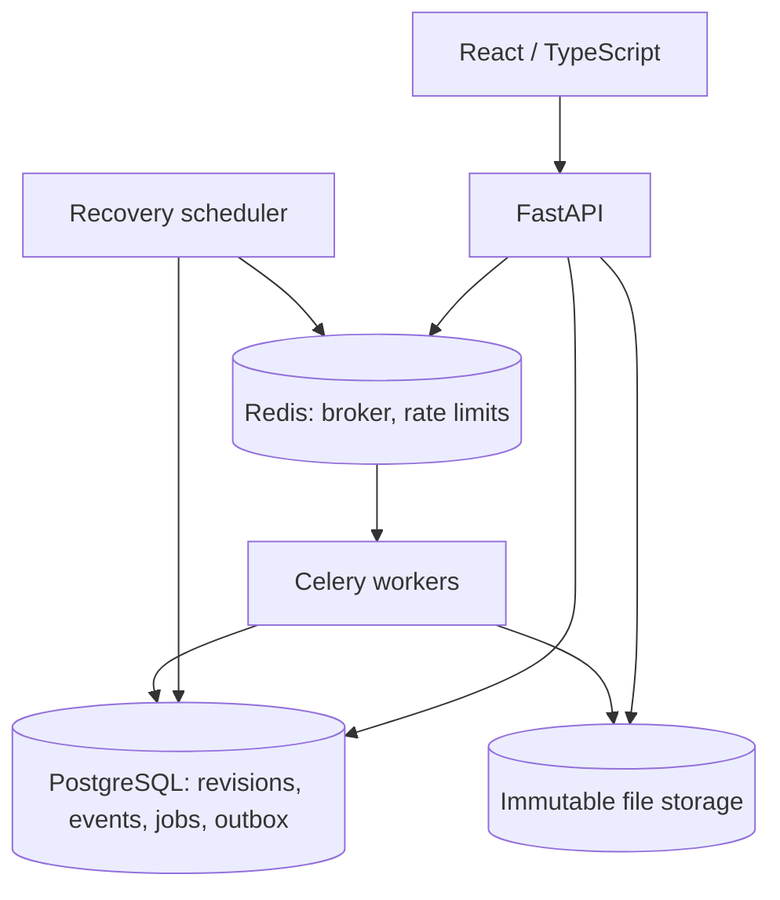

# DataFlow — Data Analytics Platform

[](https://github.com/MauricioTaguchi/data-analytics-platform/actions/workflows/ci.yml)
[](https://github.com/MauricioTaguchi/data-analytics-platform/actions/workflows/codeql.yml)
[](https://www.python.org/)
[](https://react.dev/)
[](LICENSE)

DataFlow is a production-minded analytics workspace that moves a dataset from ingestion to a decision-ready dashboard or PDF report. It makes data quality, background processing, version conflicts, lineage, and operational status visible instead of hiding them behind isolated API calls.

> **Project status:** this is a portfolio/reference implementation, not a claim of proven production readiness. It demonstrates production-minded boundaries and failure handling, while managed object storage, tested backup restoration, high availability, centralized telemetry, formal service objectives, and an independent security review remain deployment responsibilities. See [Known limitations](docs/LIMITATIONS.md).


## Product workflow

1. Upload CSV, Excel, JSON, or Parquet with streamed size validation.
2. Import and validate the file in a Celery worker with progress and cancellation.
3. Inspect its schema, preview, missing values, duplicates, correlations, and outliers.
4. Preview a transformation and submit it with an expected version and idempotency key.
5. Track the background transformation, inspect lineage, and undo a completed version.
6. Build persisted charts and interactive dashboards.
7. Generate a PDF data-quality report or export the current dataset version.

The React application includes a safe local demo, so a reviewer can evaluate the UX without credentials. Connecting the live API enables PostgreSQL persistence, Redis-backed coordination, rotating sessions, workers, dashboards, and reports.

## Engineering highlights

| Engineering problem | Implemented boundary | Evidence |
| --- | --- | --- |
| Concurrent writes and undo | Monotonic revisions, conditional publication and PostgreSQL locks | [Concurrency tests](backend/tests/test_dataset_concurrency.py) |
| Lost undo responses and expired jobs | Transactional audit events and immutable retry receipts | [Audit receipt tests](backend/tests/test_dataset_audit_receipts.py) |
| Broker outage or lost worker | Transactional outbox, leased attempts and an independent recovery scheduler | [Recovery tests](backend/tests/test_outbox_recovery.py) |
| Filesystem and database have no shared transaction | Immutable attempt paths, durable reservations and repeatable collection | [Publication tests](backend/tests/test_transformation_publication.py), [artifact tests](backend/tests/test_artifact_lifecycle.py) |
| Different processing engines | Typed operation contracts, capability preflight and output checks | [Engine contract tests](backend/tests/test_transformation_engines.py) |
| Failure between durable writes | Real process termination, broker interruption and independent recovery | [Process integration tests](backend/integration/test_process_recovery.py) |

- Functional Overview, Datasets, Transformations, Dashboards, Reports, and Monitoring workspaces
- Responsive React + TypeScript interface with desktop and mobile Playwright journeys
- FastAPI routes with tenant isolation and consistent problem responses
- Pre-parser upload admission with declared/streamed request limits, per-process spool concurrency, preflight job/rate checks, and chunked storage validation
- A separate 1 MiB pre-parser body limit for non-upload JSON/form requests, including bodies sent without `Content-Length`
- Capacity-guarded transformation output, per-account quotas, expansion checks, and asynchronous import, profiling, transformation, and report generation
- Optimistic dataset versions, request-fingerprinted idempotency keys, explicit job leases, compensating file cleanup, and undo
- Transactional task outbox with bounded backoff so committed work survives broker or process outages
- Rotating refresh tokens with single-use server sessions and logout revocation
- PostgreSQL-backed job ownership and concurrency limits plus Redis-backed cache, broker, and multi-instance authentication/upload rate limiting
- Bounded TTL fallback only in local/test environments; Redis is mandatory in production
- PostgreSQL, Alembic-only schema management, Celery, Redis, and versioned file storage
- Ruff, MyPy, ESLint, backend and targeted frontend coverage thresholds, dependency review, Dependabot, and CodeQL
- Scheduled outbox dispatch, expired-session cleanup, orphan-file reconciliation, and bounded job-history retention

## Architecture



Transformation rules are separated from publication. The current storage implementation still uses local paths, rename and fsync; an object-storage adapter also needs an artifact-reference and local-materialization boundary. See [Architecture](docs/ARCHITECTURE.md) and [Architecture decisions](docs/DECISIONS.md).

## Run locally

Requirements: Docker Desktop and Docker Compose.

```bash
cp backend/.env.example backend/.env
docker compose up --build
```

Open:

- Product: `http://localhost:5173`
- OpenAPI: `http://localhost:8000/docs`
- Readiness: `http://localhost:8000/health/ready`

The one-shot migration service must finish successfully before the API, worker, or scheduler starts. The worker processes jobs, while the scheduler dispatches pending outbox records and removes stale, unreferenced files.

## Test and verify

```bash
cd backend
python -m pip install -r requirements-dev.txt
python -m ruff check app tests
python -m mypy app/core app/services/storage_service.py app/schemas
python -m pytest --cov=app --cov-fail-under=70

cd ../frontend
corepack enable
pnpm install --frozen-lockfile
pnpm typecheck
pnpm test
pnpm build
pnpm exec playwright install chromium
pnpm test:e2e
```

The fast suite uses eager task execution; PostgreSQL-specific tests run against a real database in CI. A separate process integration job runs API, Redis delivery, Celery workers and recovery schedulers without eager mode. CI also validates migrations, dependency audits, lint, type checks and frontend journeys. Configured coverage thresholds are gates, not measured capacity claims.

New transformation outputs use Parquet to retain column types; original uploads and historical snapshots remain available for undo. A preview materializes through the selected adapter before returning a sample. It does not mutate the dataset. Parquet dataset pagination reads only the requested columns and relevant row groups.

## Core API workflow

- `POST /api/v1/datasets/project/{project_id}` — stream an upload and enqueue import
- `GET /api/v1/datasets/jobs/{task_id}` — inspect progress and result
- `DELETE /api/v1/datasets/jobs/{task_id}` — cancel an owned job
- `GET /api/v1/datasets/{dataset_id}/preview` — read a paginated preview
- `POST /api/v1/datasets/{dataset_id}/profile` — enqueue profiling
- `POST /api/v1/datasets/{dataset_id}/transform/preview` — enqueue a dry-run against an expected version
- `POST /api/v1/datasets/{dataset_id}/transform` — enqueue an idempotent transformation
- `POST /api/v1/datasets/{dataset_id}/transformations/undo` — restore previous content with `{"expected_version": 3}`; the revision keeps increasing
- `GET /api/v1/datasets/{dataset_id}/events` — inspect committed transformation and undo events
- `GET /api/v1/datasets/operations` — discover typed parameters and engine capabilities
- `POST /api/v1/dashboards` and `/dashboards/{id}/charts` — create persisted visualizations
- `POST /api/v1/reports/project/{project_id}/dataset/{dataset_id}` — enqueue a PDF report
- `DELETE /api/v1/reports/{report_id}` — remove a terminal report and release its storage

Authentication supports registration, login, automatic refresh-token rotation, and logout/revocation.

## Deliberate trade-offs

- Local versioned files keep the project easy to run; horizontally scaled production should use encrypted object storage.
- The upload receive cap is process-local; total concurrent uploads scale with API worker count, so production still needs edge request-size, timeout, and connection limits.
- Application request guards bound bodies seen by FastAPI, but they complement rather than replace reverse-proxy and ASGI-server limits for slow or unread request streams.
- Pandas remains the default for bounded workloads. Optional Polars and DuckDB adapters process Parquet projections in supervised subprocesses; other operations remain explicit capabilities of Pandas. Native memory and spill watchdogs complement container resource limits.
- The local demo is intentionally non-persistent and clearly labeled.
- Chart aggregation is synchronous today and bounded by the dataset limit; expensive analytical queries can move to a dedicated query worker later.

## Documentation

- [Architecture](docs/ARCHITECTURE.md)
- [API examples](docs/API_EXAMPLES.md)
- [Deployment guide](docs/DEPLOYMENT.md)
- [Operations and observability](docs/OPERATIONS.md)
- [Processing, recovery, and upgrade procedure](docs/PROCESSING_RECOVERY.md)
- [Audit events and idempotent undo receipts](docs/AUDIT_RECEIPTS.md)
- [Release process](docs/RELEASES.md)
- [Known limitations](docs/LIMITATIONS.md)
- [Security model](docs/SECURITY.md)
- [Architecture decisions](docs/DECISIONS.md)
- [Contributing](CONTRIBUTING.md)

## Next engineering milestones

- S3/MinIO storage adapter with encrypted objects and signed downloads
- OpenTelemetry traces and centralized error monitoring
- Column-level validation contracts and scheduled quality rules
- Measured memory/latency benchmarks, incremental quota accounting and explicit snapshot-retention windows
- Visual regression snapshots for dashboard states
- Distributed processing beyond single-node memory

## License

MIT
